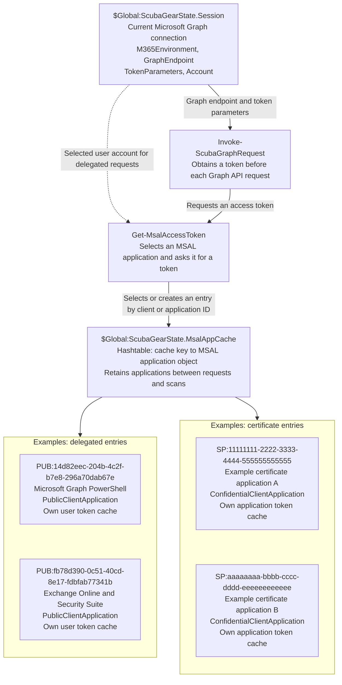

# MSAL integration tracker

## Authentication state and token caches

`$Global:ScubaGearState` has two objects responsible for authentication context and cached MSAL applications: `Session` and `MsalAppCache`. They stay in memory only for the length of a scan by default: `Invoke-SCuBA` and `Invoke-SCuBACached` (when it signs in) clear both when they finish, because `DisconnectOnExit` defaults to true. The cleanup also runs when sign-in, tenant lookup, or the scan fails or is cancelled. With `-DisconnectOnExit:$false` they stay in memory between scans in the same PowerShell process. `MsalValidated` and `MsalLibraryPath` track library setup separately.



The cache entries illustrate delegated and certificate authentication alternatives. A scan uses its selected authentication mode; the two certificate application IDs are fictional examples, not built-in ScubaGear client IDs.

- **`Session` describes the current Graph connection.** `TokenParameters` holds the Graph scopes, tenant, environment, and either a delegated `ClientId` or certificate `AppID` and thumbprint. `Account` identifies the selected user for delegated authentication and is null for certificate authentication. `Get-ScubaGearContext` uses this session to query Graph for the tenant, username, application name, and other context. Access and refresh tokens are held in MSAL's caches rather than in `Session`.
- **`MsalAppCache` retains the MSAL application objects that own the token caches.** `Get-MsalAccessToken` chooses `PUB:<ClientId>` for delegated authentication or `SP:<AppID>` for certificate authentication. The dictionary values are application objects, not access tokens. Each object retains its own token cache, allowing later requests to acquire tokens without starting a new browser authorization when cached credentials suffice. Cache contents are not copied between application objects.

Some example keys and their uses are:

| Cache key | Used for |
| --- | --- |
| `PUB:14d82eec-204b-4c2f-b7e8-296a70dab67e` | Graph discovery, the tenant-specific Graph connection, and subsequent Graph API requests all use this same object. |
| `PUB:fb78d390-0c51-40cd-8e17-fdbfab77341b` | Exchange Online and Security Suite share an object because their configured client IDs match. |
| `PUB:1950a258-227b-4e31-a9cf-717495945fc2` | Power BI and Power Platform share an object because their configured client IDs match. |
| `SP:11111111-2222-3333-4444-555555555555` | Example certificate application A; Graph and other product resources use its own application token cache. |
| `SP:aaaaaaaa-bbbb-cccc-dddd-eeeeeeeeeeee` | Alternative example certificate application B, with a different application ID. |

The delegated client IDs come from `AuthenticationClientIdHashtable` in `ScubaConfigDefaults.json`; certificate application IDs are supplied by the user. Scopes and resource audiences still distinguish tokens inside each MSAL cache even when multiple products share one application object.

During discovery, `Connect-GraphHelper` obtains the initial Graph token and discovers the tenant and cloud. Its next token request uses the same `PUB:<ClientId>` entry for the tenant connection. Only after both steps succeed does it publish `Session`. Later `Invoke-ScubaGraphRequest` calls read the session's token parameters and ask `Get-MsalAccessToken` for a token from that same application. Other products supply their own token parameters and use the Graph session's selected user account for delegated authentication.

`Session` does not hold a direct reference to a cached application or its token cache. The relationship runs through `Get-MsalAccessToken`, which derives the cache key from the requested `ClientId` or `AppID`. `Disconnect-SCuBATenant` calls `Disconnect-ScubaGraph` to set `Session` to null and empty `MsalAppCache`. Disconnect before changing tenants or credentials. ScubaGear does this at the end of every run by default, so an explicit call is only needed when `-DisconnectOnExit:$false` keeps the session.

## Restoration checkpoint

- Pre-integration commit: `721e7e1e544c8ec507a0b0b9c02c73e73ff10550`
- Branch at capture: `2305-the-current-msal-auth-in-main-is-pulling-via-interactive-code-that-spawns-a-web-browser-for-authentication`
- Capture date: 2026-07-31
- The working tree was dirty. No automatic checkpoint commit or tag was created because that would combine pre-existing user work with this migration.

Files modified before this integration began:

- `PowerShell/ScubaGear/Modules/Connection/ConnectHelpers.psm1`
- `PowerShell/ScubaGear/Modules/Connection/Connection.psm1`
- `PowerShell/ScubaGear/Modules/Orchestrator.psm1`
- `PowerShell/ScubaGear/schemas/ScubaConfigDefaults.json`
- `PowerShell/ScubaGear/Modules/ScubaConfig/ScubaConfigSchema.json`
- `PowerShell/ScubaGear/Modules/Support/Support.psm1`
- `PowerShell/ScubaGear/Sample-Config-Files/full_config.yaml`
- `PowerShell/ScubaGear/Testing/Unit/PowerShell/Connection/Connect-GraphHelper.Tests.ps1`
- `PowerShell/ScubaGear/Testing/Unit/PowerShell/Connection/Connect-Tenant.Tests.ps1`
- `PowerShell/ScubaGear/Testing/Unit/PowerShell/Orchestrator/Connect-Tenant.Tests.ps1`
- `PowerShell/ScubaGear/Testing/Unit/PowerShell/Orchestrator/Invoke-Scuba.Tests.ps1`
- `PowerShell/ScubaGear/Testing/Unit/PowerShell/ScubaConfig/ScubaConfig.JsonDefaults.Tests.ps1`
- `PowerShell/ScubaGear/Testing/Unit/PowerShell/ScubaConfig/ScubaConfig.JsonSchema.Tests.ps1`
- `PowerShell/ScubaGear/Testing/Unit/PowerShell/Support/New-SCuBAConfig.Tests.ps1`
- `docs/configuration/parameters.md`

To inspect the committed baseline without changing the current worktree:

```powershell
git worktree add ..\SCUBA2305-pre-msal 721e7e1e544c8ec507a0b0b9c02c73e73ff10550
```

## Compatibility decision

ScubaGear pins `Microsoft.Identity.Client` 4.89.0. The signed assemblies are not bundled in the repo; they are downloaded from NuGet on first use and cached under `~/.scubagear/MSAL/<version>/net462`, mirroring how the OPA executable is handled. Interactive authentication uses the system browser only (loopback redirect); the WAM broker and its native runtime are not used. Newer MSAL versions are advisory until signature and hash integrity validation passes.

On the first interactive scan, `Connect-GraphHelper -Discovery` signs in with the first-party Microsoft Graph PowerShell client and MSAL's `WithMultiCloudSupport` option at the public `organizations` authority. The returned account cloud and tenant ID select the tenant metadata endpoint; `tenant_region_sub_scope` distinguishes GCC, GCC High, and DoD. `Get-MsalAccessToken` caches one delegated MSAL application per client ID under `PUB:<ClientId>`, so discovery, the tenant-specific connection, and subsequent Graph requests automatically reuse the same object and its token cache. Callers do not supply cache keys. `ForCloudDiscovery` controls MSAL configuration when the application is first created; later calls retain that configuration. The global Graph session is published only after discovery and tenant-specific authentication succeed. Both `Invoke-SCuBA` and provider-exporting `Invoke-SCuBACached` runs propagate the detected environment to product endpoints and reports. Interactive scans discover the environment regardless of an explicitly supplied environment, then reuse the established session on later scans when `-DisconnectOnExit:$false` keeps it. Unknown clouds, missing metadata, or conflicting cloud information are errors, not a commercial fallback.

The Graph session (`$Global:ScubaGearState.Session`) stores the environment, Graph endpoint, token-request parameters, and selected MSAL account. Graph REST requests use this context to obtain a token from MSAL before sending each request. Access and refresh tokens are held separately in MSAL, not in this session hashtable. When the session is kept with `-DisconnectOnExit:$false`, later scans reuse the Graph context and its environment without repeating automatic discovery. A later scan that adds `aad` acquires any additional required Graph scopes before updating the session's token request parameters. Explicit disconnect clears both the context and cached credentials; call `Disconnect-SCuBATenant` before switching tenants or credentials.

Each MSAL application retains its own token cache in memory through `$Global:ScubaGearState.MsalAppCache`; ScubaGear does not copy or serialize token caches between applications. Product requests use the selected Graph account to keep the same user across products. Separate client IDs may require browser authorization on the first request; later requests in the same scan, and later scans when the session is kept, reuse each application's cached credentials. A Graph HTTP 401 triggers a forced token refresh using the same Graph application object. App-only certificate authentication continues to use its separate MSAL application cache. Tokens are not written to disk.

Once Graph has selected an account, product clients pass that `IAccount` directly to `AcquireTokenSilent`, even if the new client's `GetAccountsAsync` would return no accounts. Account enumeration is only used when there is no selected Graph account. A missing per-client account listing does not prove that silent acquisition is impossible; MSAL performs the credential lookup. If the silent request fails, verbose diagnostics include the underlying MSAL error code when available. Browser SSO is the fallback only for `MsalUiRequiredException`, including missing refresh credentials (`no_tokens_found`) and consent or MFA requirements. Other failures propagate to the error handler without opening the browser.

#### Retries, cancellation, and Ctrl-C

`Get-MsalAccessToken` makes up to three attempts, but only for transient failures: service timeouts or unavailability (`request_timeout`, `temporarily_unavailable`, `service_not_available`, HTTP 408/429/5xx) and network or connection errors. Failures that need the user to act are never retried, because a retry would show the same prompt again. These include a cancelled or timed-out sign-in, wrong credentials, a consent that the signed-in user cannot grant, Conditional Access blocks, and an unusable app registration. ScubaGear prints a short explanation for the common cases and stops.

Requests are cancellable. The wait for MSAL runs in short slices, so Ctrl-C stops the sign-in and releases the local redirect listener instead of freezing the PowerShell window. An interactive browser sign-in that is abandoned (for example, the tab was closed) is cancelled after five minutes.

When cache-only acquisition fails after an account has been selected, the browser request supplies that account with `WithAccount` and uses `Prompt.NoPrompt`. This omits MSAL's default forced account selector and lets Entra reuse the browser sign-in session. The browser can still open for each client; this is browser SSO rather than cache-only acquisition. Consent and authentication-policy requirements can still display additional UI. The first request, without a selected account, retains the SDK's default account-selection behavior. `-Verbose` is forwarded explicitly through orchestration, connection, discovery, and Graph helpers so token-acquisition diagnostics remain visible across script-module boundaries.

Missing per-client credentials, consent, and Conditional Access can still require interactive authentication. Local tests simulate each client's token cache and both discovery-first and explicit-connection-first entry paths; they do not guarantee a single prompt in a live tenant. To validate live behavior, start a fresh PowerShell process, import the working copy, run the usual `Invoke-SCuBA` command with `-Verbose` and `-DisconnectOnExit:$false` twice in that process, and compare browser prompts and verbose messages. Run `Get-ScubaGearContext` to confirm the account and tenant, then `Disconnect-SCuBATenant` when finished. Certificate applications retain separate cache entries under `SP:<AppID>`. Disconnect before switching tenants or certificates.

## Migration status

- [x] Lock the complete NuGet dependency closure.
- [x] Verify NuGet and Authenticode signatures.
- [x] Download and cache managed MSAL files into `~/.scubagear/MSAL` at install and runtime.
- [x] Record the pinned versions, hashes, and signer in `RequiredVersions.ps1` (`$MsalDependency`).
- [x] Replace Graph Authentication assembly discovery.
- [x] Use system-browser delegated authentication (WAM broker removed).
- [x] Add internal Graph session and REST transport.
- [x] Replace executable Graph Authentication cmdlet calls.
- [x] Remove Microsoft.Graph.Authentication from RequiredVersions.ps1.
- [ ] Complete live certificate authentication tests.
- [ ] Complete sovereign-cloud tenant tests where tenants are available.
